:lucide-file-down:

# Every free PDF. One right-click.

ZotPDF finds open-access PDFs for your Zotero references from 15 free sources, flags retracted papers, and audits citation metadata.

[:lucide-download: Download zotpdf.xpi](https://github.com/noahweidig/zotpdf/releases/latest/download/zotpdf.xpi){ .md-button .md-button--primary }
[:lucide-book-open: Install guide](install.md){ .md-button }
[:octicons-mark-github-16: GitHub](https://github.com/noahweidig/zotpdf){ .md-button }

  
<strong>15</strong><small>free sources</small>

  
<strong>0</strong><small>accounts needed</small>

  
<strong>3</strong><small>checks in one menu</small>

  UnpaywallPubMed CentralEurope PMCSemantic ScholarCrossrefCOREOpenAIREarXivbioRxivmedRxivOSFZenodoFigshareHALDOAJOSTIOpenAlexInternet Archive

- :lucide-file-down:{ .lg .middle } **Find PDFs**

    ---

    One pass through every free source. The first real PDF wins and the result names it. Matches by DOI, PMID, arXiv ID or exact title. Tags every item; **never creates notes**.

    [:lucide-arrow-right: How it works](how-it-works.md)

- :lucide-shield-alert:{ .lg .middle } **Check retractions**

    ---

    Reads PubMed and Crossref, which carries the Retraction Watch database, so mass retractions PubMed never indexed get caught too.

    [:lucide-arrow-right: Retraction check](checks.md)

- :lucide-list-checks:{ .lg .middle } **Audit metadata**

    ---

    Compares each record with Crossref and flags missing fields and mismatches. A mismatch often means the wrong DOI. Read-only: nothing is edited.

    [:lucide-arrow-right: Metadata check](checks.md#citation-metadata)

- :lucide-layers:{ .lg .middle } **One menu, one table**

    ---

    Right-click, **ZotPDF**. Find PDFs, check retractions, check metadata, or run all three. Progress shows in one table with Cancel.

    [:lucide-arrow-right: Use it](usage.md)

- :lucide-settings:{ .lg .middle } **Every source is a switch**

    ---

    Turn any source off, add optional keys for CORE or Semantic Scholar, or stay strictly open access by disabling the last-resort publisher step.

    [:lucide-arrow-right: Settings](settings.md)

- :lucide-lock:{ .lg .middle } **Private by design**

    ---

    Your library is read locally. Only identifiers and titles go to the services you leave switched on. No accounts, no analytics.

    [:lucide-arrow-right: Privacy](privacy.md)

## The PDF chain

```mermaid
flowchart LR
  A[Item] --> B[Unpaywall]
  B --> C[PubMed Central]
  C --> D[Europe PMC]
  D --> E[Semantic Scholar]
  E --> F[Crossref]
  F --> G[CORE]
  G --> H[OpenAIRE]
  H --> I[Preprint servers]
  I --> J[HAL, DOAJ, OSTI]
  J --> K[OpenAlex]
  K --> L[Internet Archive]
  L --> M[Free-to-read pages]
```

Requires Zotero 7 or later on macOS, Windows or Linux. Free and open source.
